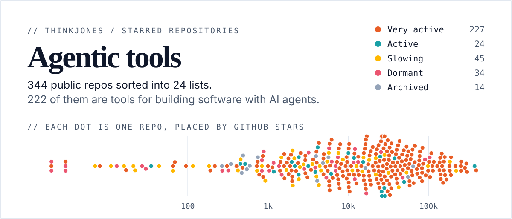
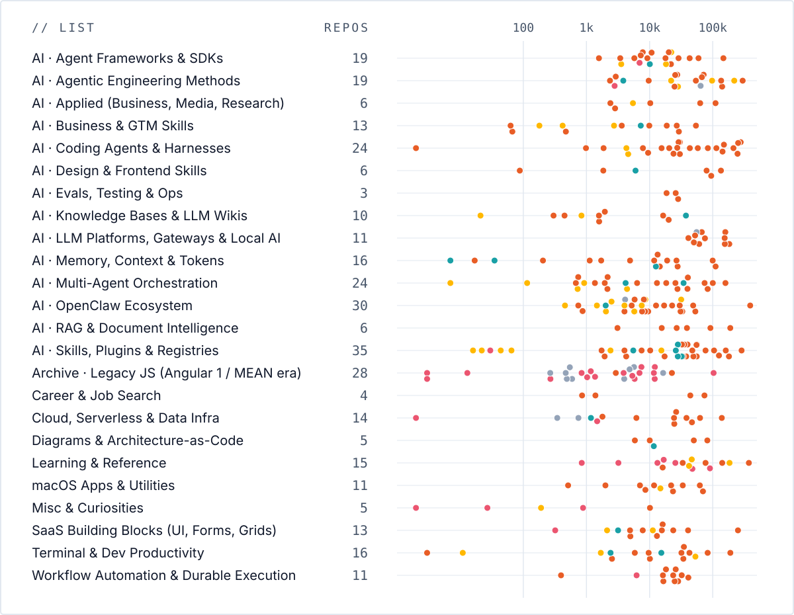

<p align="center">
  
</p>

<!-- summary:start -->
344 public GitHub repositories I have starred, sorted into 24 lists. 222 of them are tools for building software with AI agents: frameworks, coding harnesses, orchestration, memory, skills and evals. The rest are the terminal tools, infrastructure and references around them. Snapshot taken 2026-10-27.
<!-- summary:end -->

**[Browse, search and filter the list on the site](https://thinkjones.github.io/agentic-tools/)**, or read it below. The same data is published as [CSV](./starred_repos.csv), [TOML](./starred_repos.toml) and [JSON](./starred_repos.json) for other tools to import.

<p align="center">
  
</p>

## Lists

<!-- contents:start -->
| List | Repos | Most starred |
| --- | ---: | --- |
| [AI · Agent Frameworks &amp; SDKs](#list-01) | 19 | [langchain-ai/langchain](https://github.com/langchain-ai/langchain) |
| [AI · Agentic Engineering Methods](#list-02) | 19 | [obra/superpowers](https://github.com/obra/superpowers) |
| [AI · Applied (Business, Media, Research)](#list-03) | 6 | [TauricResearch/TradingAgents](https://github.com/TauricResearch/TradingAgents) |
| [AI · Business &amp; GTM Skills](#list-04) | 13 | [coreyhaines31/marketingskills](https://github.com/coreyhaines31/marketingskills) |
| [AI · Coding Agents &amp; Harnesses](#list-05) | 24 | [affaan-m/ECC](https://github.com/affaan-m/ECC) |
| [AI · Design &amp; Frontend Skills](#list-06) | 6 | [nextlevelbuilder/ui-ux-pro-max-skill](https://github.com/nextlevelbuilder/ui-ux-pro-max-skill) |
| [AI · Evals, Testing &amp; Ops](#list-07) | 3 | [mlflow/mlflow](https://github.com/mlflow/mlflow) |
| [AI · Knowledge Bases &amp; LLM Wikis](#list-08) | 10 | [khoj-ai/khoj](https://github.com/khoj-ai/khoj) |
| [AI · LLM Platforms, Gateways &amp; Local AI](#list-09) | 11 | [ollama/ollama](https://github.com/ollama/ollama) |
| [AI · Memory, Context &amp; Tokens](#list-10) | 16 | [JuliusBrussee/caveman](https://github.com/JuliusBrussee/caveman) |
| [AI · Multi-Agent Orchestration](#list-11) | 24 | [msitarzewski/agency-agents](https://github.com/msitarzewski/agency-agents) |
| [AI · OpenClaw Ecosystem](#list-12) | 30 | [openclaw/openclaw](https://github.com/openclaw/openclaw) |
| [AI · RAG &amp; Document Intelligence](#list-13) | 6 | [microsoft/markitdown](https://github.com/microsoft/markitdown) |
| [AI · Skills, Plugins &amp; Registries](#list-14) | 35 | [mattpocock/skills](https://github.com/mattpocock/skills) |
| [Archive · Legacy JS (Angular 1 / MEAN era)](#list-15) | 28 | [react/create-react-app](https://github.com/react/create-react-app) |
| [Career &amp; Job Search](#list-16) | 4 | [career-ops-hq/career-ops](https://github.com/career-ops-hq/career-ops) |
| [Cloud, Serverless &amp; Data Infra](#list-17) | 14 | [ripienaar/free-for-dev](https://github.com/ripienaar/free-for-dev) |
| [Diagrams &amp; Architecture-as-Code](#list-18) | 5 | [tt-a1i/archify](https://github.com/tt-a1i/archify) |
| [Learning &amp; Reference](#list-19) | 15 | [donnemartin/system-design-primer](https://github.com/donnemartin/system-design-primer) |
| [macOS Apps &amp; Utilities](#list-20) | 11 | [tw93/Mole](https://github.com/tw93/Mole) |
| [Misc &amp; Curiosities](#list-21) | 5 | [stanfordnlp/CoreNLP](https://github.com/stanfordnlp/CoreNLP) |
| [SaaS Building Blocks (UI, Forms, Grids)](#list-22) | 13 | [react/react](https://github.com/react/react) |
| [Terminal &amp; Dev Productivity](#list-23) | 16 | [ohmyzsh/ohmyzsh](https://github.com/ohmyzsh/ohmyzsh) |
| [Workflow Automation &amp; Durable Execution](#list-24) | 11 | [ToolJet/ToolJet](https://github.com/ToolJet/ToolJet) |
<!-- contents:end -->

## Reading the activity column

Activity is set when the snapshot is taken, from the date of the last push.

| Label | Last push |
| --- | --- |
| 🟠 Very active | Within 31 days of the snapshot |
| 🔵 Active | Within 92 days |
| 🟡 Slowing | Within a year |
| 🔴 Dormant | More than a year before |
| ⚫ Archived | Any date; the repository is archived |

## Use the data

| File | Use it for |
| --- | --- |
| [`starred_repos.csv`](./starred_repos.csv) | The source. Spreadsheets and anything that reads CSV. |
| [`starred_repos.toml`](./starred_repos.toml) | Config-driven tools. One `[[repos]]` table per repository. |
| [`starred_repos.json`](./starred_repos.json) | Scripts and the site. Same keys as the TOML. |

Each file is also served from the site, for example `https://thinkjones.github.io/agentic-tools/starred_repos.toml`.

```toml
[[repos]]
list = "AI · Agent Frameworks & SDKs"
repo = "langchain-ai/langchain"
url = "https://github.com/langchain-ai/langchain"
stars = 147561
forks = 24753
activity = "Very active"
last_push = 2026-10-10
last_release = "langchain-core==1.6.9"
release_date = 2026-10-08
license = "MIT"
language = "Python"
homepage = "https://docs.langchain.com/langchain/"
topics = ["agents", "ai", "ai-agents"]
description = "The agent engineering platform."
starred_on = 2026-03-24
```

```python
import tomllib

with open("starred_repos.toml", "rb") as f:
    repos = tomllib.load(f)["repos"]

active_rust = [r["repo"] for r in repos if r.get("language") == "Rust" and r["activity"] == "Very active"]
```

| Key | CSV column | Type | Notes |
| --- | --- | --- | --- |
| `list` | Proposed List | string | |
| `repo` | Repo | string | `owner/name` |
| `url` | URL | string | |
| `stars`, `forks` | Stars, Forks | integer | |
| `activity` | Activity | string | One of the five labels above |
| `last_push`, `release_date`, `starred_on` | Last Push, Release Date, Starred On | date | TOML local date; `YYYY-MM-DD` string in JSON |
| `last_release` | Last Release | string | Release tag |
| `license` | License | string | SPDX identifier; `NOASSERTION` means GitHub found a license it could not classify |
| `language` | Language | string | Primary language |
| `homepage` | Homepage | string | |
| `topics` | Topics | array of strings | |
| `description` | Description | string | |

A key is left out when the CSV cell is empty, so read optional keys with a default. `list`, `repo`, `url`, `stars`, `forks`, `activity`, `last_push` and `starred_on` are always present.

## The lists

Repos are ordered by stars within each list. Descriptions longer than 150 characters are shortened here; the data files hold the full text.

<!-- lists:start -->
<a id="list-01"></a>

### AI · Agent Frameworks & SDKs

| Repo | Stars | Language | Activity | Last push |
| --- | ---: | --- | --- | --- |
| [**langchain-ai/langchain**](https://github.com/langchain-ai/langchain)<br>The agent engineering platform. | 148.5k | Python | 🟠 Very active | 2026-10-27 |
| [**crewAIInc/crewAI**](https://github.com/crewAIInc/crewAI)<br>Framework for orchestrating role-playing, autonomous AI agents. By fostering collaborative intelligence, CrewAI empowers agents to work together seam… | 60.1k | Python | 🟠 Very active | 2026-10-27 |
| [**langchain-ai/langgraph**](https://github.com/langchain-ai/langgraph)<br>Build resilient agents. | 44.0k | Python | 🟠 Very active | 2026-10-27 |
| [**mastra-ai/mastra**](https://github.com/mastra-ai/mastra)<br>Mastra is the modern TypeScript framework for AI-powered applications and agents. | 29.1k | TypeScript | 🟠 Very active | 2026-10-27 |
| [**openai/swarm**](https://github.com/openai/swarm)<br>Educational framework exploring ergonomic, lightweight multi-agent orchestration. Managed by OpenAI Solution team. | 22.1k | Python | 🟡 Slowing | 2026-04-15 |
| [**google/adk-python**](https://github.com/google/adk-python)<br>An open-source, code-first Python toolkit for building, evaluating, and deploying sophisticated AI agents with flexibility and control. | 22.0k | Python | 🟠 Very active | 2026-10-27 |
| [**camel-ai/owl**](https://github.com/camel-ai/owl)<br>🦉 OWL: Optimized Workforce Learning for General Multi-Agent Assistance in Real-World Task Automation | 20.2k | Python | 🟠 Very active | 2026-10-19 |
| [**RightNow-AI/openfang**](https://github.com/RightNow-AI/openfang)<br>Open-source Agent Operating System | 18.2k | Rust | 🟡 Slowing | 2026-07-02 |
| [**camel-ai/camel**](https://github.com/camel-ai/camel)<br>🐫 CAMEL: The first and the best multi-agent framework. Finding the Scaling Law of Agents. https://www.camel-ai.org | 18.0k | Python | 🟠 Very active | 2026-10-19 |
| [**VoltAgent/voltagent**](https://github.com/VoltAgent/voltagent)<br>AI Agent Engineering Platform built on an Open Source TypeScript AI Agent Framework | 10.9k | TypeScript | 🟠 Very active | 2026-10-15 |
| [**GetBindu/Bindu**](https://github.com/GetBindu/Bindu)<br>Bindu: The identity, communication, and payments layer for AI agents. | 10.0k | Python | 🔵 Active | 2026-09-06 |
| [**MervinPraison/PraisonAI**](https://github.com/MervinPraison/PraisonAI)<br>PraisonAI 🦞 — Hire a 24/7 AI Workforce. Stop writing boilerplate and start shipping autonomous self-improving agents that research, plan, code, and e… | 9.3k | Python | 🟠 Very active | 2026-10-26 |
| [**2FastLabs/agent-squad**](https://github.com/2FastLabs/agent-squad)<br>Flexible and powerful framework for managing multiple AI agents and handling complex conversations | 7.8k | Python | 🟠 Very active | 2026-10-08 |
| [**kyegomez/swarms**](https://github.com/kyegomez/swarms)<br>The Enterprise-Grade Multi-Agent Orchestration Framework. Website: https://swarms.ai | 7.3k | Python | 🟠 Very active | 2026-10-27 |
| [**InternLM/MindSearch**](https://github.com/InternLM/MindSearch)<br>🔍 An LLM-based Multi-agent Framework of Web Search Engine (like Perplexity.ai Pro and SearchGPT) | 6.9k | JavaScript | 🔴 Dormant | 2025-07-04 |
| [**agentscope-ai/AgentTeams**](https://github.com/agentscope-ai/AgentTeams)<br>An open-source Collaborative Multi-Agent OS for transparent, human-in-the-loop task coordination via Matrix rooms. | 5.9k | Go | 🟠 Very active | 2026-10-26 |
| [**SkyworkAI/DeepResearchAgent**](https://github.com/SkyworkAI/DeepResearchAgent)<br>DeepResearchAgent is a hierarchical multi-agent system designed not only for deep research tasks but also for general-purpose task solving. The frame… | 3.6k | Python | 🟡 Slowing | 2026-05-04 |
| [**i-am-bee/beeai-framework**](https://github.com/i-am-bee/beeai-framework)<br>Build production-ready AI agents in both Python and Typescript. | 3.4k | Python | 🟠 Very active | 2026-10-26 |
| [**langchain-ai/langgraph-swarm-py**](https://github.com/langchain-ai/langgraph-swarm-py)<br>For your multi-agent needs | 1.6k | Python | 🟠 Very active | 2026-10-26 |

<a id="list-02"></a>

### AI · Agentic Engineering Methods

| Repo | Stars | Language | Activity | Last push |
| --- | ---: | --- | --- | --- |
| [**obra/superpowers**](https://github.com/obra/superpowers)<br>An agentic skills framework &amp; software development methodology that works. | 305.7k | Shell | 🟠 Very active | 2026-10-23 |
| [**multica-ai/andrej-karpathy-skills**](https://github.com/multica-ai/andrej-karpathy-skills)<br>A single CLAUDE.md file to improve Claude Code behavior, derived from Andrej Karpathy's observations on LLM coding pitfalls. | 224.9k |  | 🟡 Slowing | 2026-04-20 |
| [**github/spec-kit**](https://github.com/github/spec-kit)<br>💫 Toolkit to help you get started with SDD or any other process! | 143.1k | Python | 🟠 Very active | 2026-10-26 |
| [**garrytan/gstack**](https://github.com/garrytan/gstack)<br>Use Garry Tan's exact Claude Code setup: 23 opinionated tools that serve as CEO, Designer, Eng Manager, Release Manager, Doc Engineer, and QA | 137.9k | TypeScript | 🟠 Very active | 2026-10-27 |
| [**karpathy/autoresearch**](https://github.com/karpathy/autoresearch)<br>AI agents running research on single-GPU nanochat training automatically | 98.7k | Python | 🟡 Slowing | 2026-03-26 |
| [**Fission-AI/OpenSpec**](https://github.com/Fission-AI/OpenSpec)<br>Spec-driven development (SDD) for AI coding assistants. | 73.1k | TypeScript | 🟠 Very active | 2026-10-26 |
| [**shanraisshan/claude-code-best-practice**](https://github.com/shanraisshan/claude-code-best-practice)<br>from vibe coding to agentic engineering - practice makes claude perfect | 68.2k | HTML | 🟠 Very active | 2026-10-27 |
| [**gsd-build/get-shit-done**](https://github.com/gsd-build/get-shit-done)<br>A light-weight and powerful meta-prompting, context engineering and spec-driven development system for Claude Code by TÂCHES. | 64.2k | JavaScript | ⚫ Archived | 2026-05-31 |
| [**bmad-code-org/BMAD-METHOD**](https://github.com/bmad-code-org/BMAD-METHOD)<br>Breakthrough Method for Agile Ai Driven Development | 54.6k | Python | 🟠 Very active | 2026-10-20 |
| [**eyaltoledano/claude-task-master**](https://github.com/eyaltoledano/claude-task-master)<br>An AI-powered task-management system you can drop into Cursor, Lovable, Windsurf, Roo, and others. | 28.3k | JavaScript | 🟡 Slowing | 2026-04-28 |
| [**OthmanAdi/planning-with-files**](https://github.com/OthmanAdi/planning-with-files)<br>Persistent file-based planning for AI coding agents and long-running tasks. Crash-proof markdown plans, session recovery after /clear and compaction,… | 27.7k | Python | 🟠 Very active | 2026-10-24 |
| [**EveryInc/compound-engineering-plugin**](https://github.com/EveryInc/compound-engineering-plugin)<br>Official Compound Engineering plugin for Claude Code, Codex, Cursor, and more | 25.7k | TypeScript | 🟠 Very active | 2026-10-27 |
| [**agentsmd/agents.md**](https://github.com/agentsmd/agents.md)<br>AGENTS.md — a simple, open format for guiding coding agents | 25.2k | TypeScript | 🔵 Active | 2026-09-10 |
| [**snarktank/ralph**](https://github.com/snarktank/ralph)<br>Ralph is an autonomous AI agent loop that runs repeatedly until all PRD items are complete. | 22.1k | TypeScript | 🟡 Slowing | 2026-02-02 |
| [**frankbria/ralph-claude-code**](https://github.com/frankbria/ralph-claude-code)<br>Autonomous AI development loop for Claude Code with intelligent exit detection | 9.7k | Shell | 🟠 Very active | 2026-10-25 |
| [**evoiz/Agentic-Design-Patterns**](https://github.com/evoiz/Agentic-Design-Patterns) | 4.0k | Jupyter Notebook | 🟡 Slowing | 2026-07-24 |
| [**rohitg00/pro-workflow**](https://github.com/rohitg00/pro-workflow)<br>Claude Code learns from your corrections: self-correcting memory that compounds over 50+ sessions. Context engineering, parallel worktrees, agent tea… | 2.9k | JavaScript | 🟠 Very active | 2026-09-29 |
| [**twelve-factor/twelve-factor**](https://github.com/twelve-factor/twelve-factor)<br>The Twelve-Factor Manifesto | 2.8k |  | 🔴 Dormant | 2025-08-21 |
| [**nizos/tdd-guard**](https://github.com/nizos/tdd-guard)<br>Automated TDD enforcement for Claude Code | 2.4k | TypeScript | 🟠 Very active | 2026-10-26 |

<a id="list-03"></a>

### AI · Applied (Business, Media, Research)

| Repo | Stars | Language | Activity | Last push |
| --- | ---: | --- | --- | --- |
| [**TauricResearch/TradingAgents**](https://github.com/TauricResearch/TradingAgents)<br>TradingAgents: Multi-Agents LLM Financial Trading Framework | 116.6k | Python | 🟠 Very active | 2026-10-16 |
| [**remotion-dev/remotion**](https://github.com/remotion-dev/remotion)<br>🎥 Make videos programmatically with React | 68.0k | TypeScript | 🟠 Very active | 2026-10-26 |
| [**Narcooo/inkos**](https://github.com/Narcooo/inkos)<br>Story Creation AI Agent for novel, scripts, translation, interactive games, and IP content | 10.8k | TypeScript | 🟠 Very active | 2026-10-24 |
| [**business-science/ai-data-science-team**](https://github.com/business-science/ai-data-science-team)<br>An AI-powered data science team of agents to help you perform common data science tasks 10X faster. | 5.5k | Python | 🟡 Slowing | 2026-01-28 |
| [**langchain-ai/social-media-agent**](https://github.com/langchain-ai/social-media-agent)<br>📲 An agent for sourcing, curating, and scheduling social media posts with human-in-the-loop. | 3.0k | TypeScript | 🟠 Very active | 2026-10-26 |
| [**llmsresearch/paperbanana**](https://github.com/llmsresearch/paperbanana)<br>Open source implementation and extension of Google Research’s PaperBanana for automated academic figures, diagrams, and research visuals, expanded to… | 2.4k | Python | 🔵 Active | 2026-09-17 |

<a id="list-04"></a>

### AI · Business & GTM Skills

| Repo | Stars | Language | Activity | Last push |
| --- | ---: | --- | --- | --- |
| [**coreyhaines31/marketingskills**](https://github.com/coreyhaines31/marketingskills)<br>Marketing skills for Claude Code and AI agents. CRO, copywriting, SEO, analytics, and growth engineering. | 56.7k | JavaScript | 🟠 Very active | 2026-10-26 |
| [**anthropics/knowledge-work-plugins**](https://github.com/anthropics/knowledge-work-plugins)<br>Open source repository of plugins primarily intended for knowledge workers to use in Claude Cowork | 33.3k | Python | 🟠 Very active | 2026-10-27 |
| [**phuryn/pm-skills**](https://github.com/phuryn/pm-skills)<br>PM Skills Marketplace: 100+ agentic skills, commands, and plugins — from discovery to strategy, execution, launch, and growth. | 27.4k |  | 🟠 Very active | 2026-10-16 |
| [**AgriciDaniel/claude-seo**](https://github.com/AgriciDaniel/claude-seo)<br>Universal SEO skill for Claude Code. 26 sub-skills + 19 sub-agents covering technical SEO, E-E-A-T, schema, GEO/AEO, agent readiness (Lighthouse Agen… | 22.3k | Python | 🟠 Very active | 2026-10-22 |
| [**AgriciDaniel/claude-ads**](https://github.com/AgriciDaniel/claude-ads)<br>Claude-first paid-media operations skill for Claude Code across 12 ad platforms (Google, Meta, YouTube, LinkedIn, TikTok, Microsoft, Apple, Amazon, R… | 10.5k | Python | 🟠 Very active | 2026-10-17 |
| [**deanpeters/Product-Manager-Skills**](https://github.com/deanpeters/Product-Manager-Skills)<br>Product Management skills framework built on battle-tested methods for Claude Code, Cowork, Codex, and AI agents. | 7.7k | Shell | 🟠 Very active | 2026-10-16 |
| [**ericosiu/ai-marketing-skills**](https://github.com/ericosiu/ai-marketing-skills)<br>Open-source AI marketing skills — growth experiments, sales pipeline, content ops, outbound, SEO, and finance automation | 3.7k | Python | 🔵 Active | 2026-09-22 |
| [**zubair-trabzada/ai-marketing-claude**](https://github.com/zubair-trabzada/ai-marketing-claude)<br>AI Marketing Suite for Claude Code. 15 marketing skills with parallel subagents — audit any website, generate copy, email sequences, ad campaigns, co… | 2.8k | Python | 🟡 Slowing | 2026-03-02 |
| [**nimrodfisher/data-analytics-skills**](https://github.com/nimrodfisher/data-analytics-skills)<br>A comprehensive list of Claude &amp; Codex skills for a wide range of data analytics tasks | 500 | Python | 🔵 Active | 2026-09-25 |
| [**gtmagents/gtm-agents**](https://github.com/gtmagents/gtm-agents)<br>Production-ready collection of GTM agents and specialized skills for claude code. Covers sales, marketing, customer success, and revenue operations w… | 428 | Python | 🟡 Slowing | 2026-04-03 |
| [**louisblythe/Sales-Skills**](https://github.com/louisblythe/Sales-Skills)<br>Sales skills for Claude Code and AI agents. Playbooks, scripts, strategy, ICP, Sales Call Analysis, analytics, and sales engineering. | 188 |  | 🟡 Slowing | 2026-01-24 |
| [**getaero-io/gtm-eng-skills**](https://github.com/getaero-io/gtm-eng-skills)<br>10 AI agent skills for Claude Code — waterfall email enrichment, TAM building, signal discovery, job change detection, and outbound automation. Power… | 71 | TypeScript | 🟠 Very active | 2026-10-27 |
| [**LeadMagic/gtm-skills**](https://github.com/LeadMagic/gtm-skills)<br>GTM agent skills for Claude Code, Codex, and GitHub Copilot: sales, marketing, SEO, RevOps, and customer research playbooks with templates. | 68 | Python | 🟠 Very active | 2026-10-14 |

<a id="list-05"></a>

### AI · Coding Agents & Harnesses

| Repo | Stars | Language | Activity | Last push |
| --- | ---: | --- | --- | --- |
| [**affaan-m/ECC**](https://github.com/affaan-m/ECC)<br>The agent harness performance optimization system. Skills, instincts, memory, security, and research-first development for Claude Code, Codex, Openco… | 290.1k | JavaScript | 🟠 Very active | 2026-10-26 |
| [**deepseek-ai/deepseek-harness**](https://github.com/deepseek-ai/deepseek-harness)<br>DeepSeek Harness: Everything is a Plugin. | 262.9k | TypeScript | 🟠 Very active | 2026-10-23 |
| [**NousResearch/hermes-agent**](https://github.com/NousResearch/hermes-agent)<br>The agent that grows with you | 257.5k | Python | 🟠 Very active | 2026-10-27 |
| [**anomalyco/opencode**](https://github.com/anomalyco/opencode)<br>The open source coding agent. | 222.1k | TypeScript | 🟠 Very active | 2026-10-27 |
| [**anthropics/claude-code**](https://github.com/anthropics/claude-code)<br>Claude Code is an agentic coding tool that lives in your terminal, understands your codebase, and helps you code faster by executing routine tasks, e… | 153.5k | TypeScript | 🟠 Very active | 2026-10-26 |
| [**farion1231/cc-switch**](https://github.com/farion1231/cc-switch)<br>A cross-platform desktop All-in-One assistant for Claude Code, Codex, OpenCode, OpenClaw, Grok Build &amp; Hermes Agent. Only official website: ccswitch.… | 149.1k | Rust | 🟠 Very active | 2026-10-27 |
| [**earendil-works/pi**](https://github.com/earendil-works/pi)<br>AI agent toolkit: unified LLM API, agent loop, TUI, coding agent CLI | 118.1k | TypeScript | 🟠 Very active | 2026-10-27 |
| [**bytedance/deer-flow**](https://github.com/bytedance/deer-flow)<br>An open-source long-horizon SuperAgent harness that researches, codes, and creates. With the help of sandboxes, memories, tools, skill, subagents and… | 84.5k | Python | 🟠 Very active | 2026-10-27 |
| [**Alishahryar1/free-claude-code**](https://github.com/Alishahryar1/free-claude-code)<br>Use Claude Code, Codex, Antigravity, VSCode, Pi, and OpenCode (and 6 other harnesses) for free (1.3B+ free tokens) from your terminal, app, IDE, or p… | 63.8k | Python | 🟠 Very active | 2026-10-26 |
| [**herdrdev/herdr**](https://github.com/herdrdev/herdr)<br>the runtime your coding agents live on | 46.1k | Rust | 🟠 Very active | 2026-10-26 |
| [**oraios/serena**](https://github.com/oraios/serena)<br>A powerful MCP toolkit for coding, providing semantic retrieval and editing capabilities - the IDE for your agent | 30.7k | Python | 🟠 Very active | 2026-10-26 |
| [**langchain-ai/deepagents**](https://github.com/langchain-ai/deepagents)<br>The batteries-included agent harness. | 30.6k | Python | 🟠 Very active | 2026-10-27 |
| [**yamadashy/repomix**](https://github.com/yamadashy/repomix)<br>📦 Repomix is a powerful tool that packs your entire repository into a single, AI-friendly file. Perfect for when you need to feed your codebase to La… | 29.0k | TypeScript | 🟠 Very active | 2026-10-25 |
| [**Fosowl/agenticSeek**](https://github.com/Fosowl/agenticSeek)<br>Fully Local Manus AI. No APIs, No $200 monthly bills. Enjoy an autonomous agent that thinks, browses the web, and code for the sole cost of electrici… | 27.6k | Python | 🟠 Very active | 2026-10-22 |
| [**SuperClaude-Org/SuperClaude_Framework**](https://github.com/SuperClaude-Org/SuperClaude_Framework)<br>A configuration framework that enhances Claude Code with specialized commands, cognitive personas, and development methodologies. | 23.9k | Python | 🟠 Very active | 2026-09-27 |
| [**1jehuang/jcode**](https://github.com/1jehuang/jcode)<br>High performance coding agent harness written in Rust, built for heavy multi-agent dev workflows | 21.2k | Rust | 🟠 Very active | 2026-10-27 |
| [**eigent-ai/eigent**](https://github.com/eigent-ai/eigent)<br>Eigent: The Open Source Cowork Desktop - Local and Free Alternative to Claude Cowork and Codex | 15.7k | TypeScript | 🟠 Very active | 2026-10-26 |
| [**anthropics/claude-code-action**](https://github.com/anthropics/claude-code-action) | 9.7k | TypeScript | 🟠 Very active | 2026-10-26 |
| [**MoonshotAI/kimi-code**](https://github.com/MoonshotAI/kimi-code)<br>Kimi Code CLI — The Starting Point for Next-Gen Agents | 8.0k | TypeScript | 🟠 Very active | 2026-10-27 |
| [**thirdlayerinc/autoagent**](https://github.com/thirdlayerinc/autoagent)<br>autonomous harness engineering | 4.6k | Python | 🟡 Slowing | 2026-04-03 |
| [**composio-community/open-claude-cowork**](https://github.com/composio-community/open-claude-cowork)<br>Open Source version of Claude Cowork with 500+ SaaS app integrations | 4.3k | JavaScript | 🟡 Slowing | 2026-05-23 |
| [**nimbalyst/nimbalyst**](https://github.com/nimbalyst/nimbalyst)<br>Nimbalyst - The open-source visual workspace for Claude Code, Codex, and OpenCode. Run multiple coding agents in parallel, edit their work visually i… | 2.0k | TypeScript | 🟠 Very active | 2026-10-26 |
| [**opencrabs/opencrabs**](https://github.com/opencrabs/opencrabs)<br>The all-in-one AI agent. Build mobile apps, frontend, backend, manages files, deep research, schedule tasks and events. Self-improving, self-healing,… | 1.0k | Rust | 🟠 Very active | 2026-10-27 |
| [**swordsmanluke/cloche**](https://github.com/swordsmanluke/cloche)<br>An experiment in contained, self-improving coding agents. | 1 | Go | 🟠 Very active | 2026-10-07 |

<a id="list-06"></a>

### AI · Design & Frontend Skills

| Repo | Stars | Language | Activity | Last push |
| --- | ---: | --- | --- | --- |
| [**nextlevelbuilder/ui-ux-pro-max-skill**](https://github.com/nextlevelbuilder/ui-ux-pro-max-skill)<br>An AI skill that provides design intelligence for building professional UI/UX across multiple platforms. | 141.1k | Python | 🟠 Very active | 2026-10-26 |
| [**Leonxlnx/taste-skill**](https://github.com/Leonxlnx/taste-skill)<br>Agent skills that give coding agents taste: art direction, reference images and a browser check instead of generic AI pages | 103.2k | JavaScript | 🟠 Very active | 2026-10-26 |
| [**pbakaus/impeccable**](https://github.com/pbakaus/impeccable)<br>The design language that makes your AI harness better at design. | 89.5k | Rust | 🟠 Very active | 2026-10-27 |
| [**21st-dev/magic-mcp**](https://github.com/21st-dev/magic-mcp)<br>It's like v0, but in your Cursor / Claude Code / Windsurf: search 10,000+ React/Tailwind components, generate new UI with AI, and publish your own —… | 6.3k | TypeScript | 🔵 Active | 2026-09-09 |
| [**oil-oil/beautify-github-readme**](https://github.com/oil-oil/beautify-github-readme)<br>README design skill for Claude Code &amp; Codex. 帮你把 GitHub README 做得好看又好懂。 | 1.9k | Python | 🟠 Very active | 2026-10-04 |
| [**LeulAria/Aria-Icons**](https://github.com/LeulAria/Aria-Icons)<br>MCP server for 1M+ SVG icons | 102 | TypeScript | 🟠 Very active | 2026-10-17 |

<a id="list-07"></a>

### AI · Evals, Testing & Ops

| Repo | Stars | Language | Activity | Last push |
| --- | ---: | --- | --- | --- |
| [**mlflow/mlflow**](https://github.com/mlflow/mlflow)<br>The open source AI engineering platform for agents, LLMs, and ML models. MLflow enables teams of all sizes to debug, evaluate, monitor, and optimize… | 28.6k | Python | 🟠 Very active | 2026-10-27 |
| [**promptfoo/promptfoo**](https://github.com/promptfoo/promptfoo)<br>Test your prompts, agents, and RAGs. Red teaming/pentesting/vulnerability scanning for AI. Compare performance of GPT, Claude, Gemini, DeepSeek, and… | 26.5k | TypeScript | 🟠 Very active | 2026-10-26 |
| [**keploy/keploy**](https://github.com/keploy/keploy)<br>Open-source platform for creating safe, isolated production sandboxes for API, integration, and E2E testing. | 18.8k | Go | 🟠 Very active | 2026-10-27 |

<a id="list-08"></a>

### AI · Knowledge Bases & LLM Wikis

| Repo | Stars | Language | Activity | Last push |
| --- | ---: | --- | --- | --- |
| [**khoj-ai/khoj**](https://github.com/khoj-ai/khoj)<br>Your AI second brain. Self-hostable. Get answers from the web or your docs. Build custom agents, schedule automations, do deep research. Turn any onl… | 37.8k | Python | 🔵 Active | 2026-08-02 |
| [**refactoringhq/tolaria**](https://github.com/refactoringhq/tolaria)<br>Desktop app to manage markdown knowledge bases | 20.4k | TypeScript | 🟠 Very active | 2026-10-27 |
| [**MODSetter/SurfSense**](https://github.com/MODSetter/SurfSense)<br>Air-gapped, privacy-focused, open-source NotebookLM alternative. AI agent that researches, transforms, and edits your documents. Join our Discord: ht… | 16.6k | Python | 🟠 Very active | 2026-10-27 |
| [**groepl/Obsidian-Templates**](https://github.com/groepl/Obsidian-Templates)<br>A repository containing templates and scripts for #Obsidian to support the #Zettelkasten method for note-taking. | 2.0k |  | 🟠 Very active | 2026-10-06 |
| [**hydra-db/open-glean**](https://github.com/hydra-db/open-glean)<br>An open-source AI platform for knowledge work. Connect your apps, find answers, and get work done. | 1.6k | TypeScript | 🟠 Very active | 2026-10-27 |
| [**axoviq-ai/synthadoc**](https://github.com/axoviq-ai/synthadoc)<br>Synthadoc: An open-source LLM knowledge compilation engine that turns raw documents into structured, local-first wikis. A transparent, human-readable… | 1.6k | Python | 🟠 Very active | 2026-10-26 |
| [**kytmanov/obsidian-llm-wiki-local**](https://github.com/kytmanov/obsidian-llm-wiki-local)<br>Karpathy’s LLM Wiki, 100% local with Ollama. Drop Markdown notes → AI extracts concepts → your Obsidian wiki auto-links and grows. Zero sharing. Your… | 842 | Python | 🟡 Slowing | 2026-05-26 |
| [**Beever-AI/beever-atlas**](https://github.com/Beever-AI/beever-atlas)<br>Your First LLM-Wiki Conversation Knowledge Base | 451 | Python | 🔵 Active | 2026-09-10 |
| [**PixeroJan/obsidian-storyline**](https://github.com/PixeroJan/obsidian-storyline)<br>StoryLine transforms your Obsidian vault into a complete book planning and writing tool. Organize scenes, build characters, manage locations, track p… | 311 | TypeScript | 🟠 Very active | 2026-10-26 |
| [**eliavamar/repositories-wiki**](https://github.com/eliavamar/repositories-wiki) | 20 | TypeScript | 🟡 Slowing | 2026-05-06 |

<a id="list-09"></a>

### AI · LLM Platforms, Gateways & Local AI

| Repo | Stars | Language | Activity | Last push |
| --- | ---: | --- | --- | --- |
| [**ollama/ollama**](https://github.com/ollama/ollama)<br>Get up and running with Kimi, GLM, MiniMax, DeepSeek, gpt-oss, Qwen, Gemma and other models. | 184.9k | Go | 🟠 Very active | 2026-10-27 |
| [**langgenius/dify**](https://github.com/langgenius/dify)<br>Build Agentic workflows, RAG pipelines, with rich AI model and tool support on one collaborative workspace. Deploy on cloud, VPC, or self-hosted, so… | 159.7k | Python | 🟠 Very active | 2026-10-27 |
| [**open-webui/open-webui**](https://github.com/open-webui/open-webui)<br>User-friendly AI Interface (Supports Ollama, OpenAI API, ...) | 156.9k | Python | 🟠 Very active | 2026-10-27 |
| [**langflow-ai/langflow**](https://github.com/langflow-ai/langflow)<br>Langflow is a powerful tool for building and deploying AI-powered agents and workflows. | 156.1k | Python | 🟠 Very active | 2026-10-27 |
| [**cheaper-inference/OmniRoute**](https://github.com/cheaper-inference/OmniRoute)<br>Never stop coding. Free MIT AI gateway: one endpoint, 375 providers (150+ free), 1,400+ models Kimi, Claude, GPT, Gemini, GLM, DeepSeek, MiniMax. Wor… | 81.6k | TypeScript | 🟠 Very active | 2026-10-27 |
| [**Mintplex-Labs/anything-llm**](https://github.com/Mintplex-Labs/anything-llm)<br>Stop renting your intelligence. Own it with AnythingLLM. Everything you need for a powerful local-first agent experience | 67.6k | JavaScript | 🟠 Very active | 2026-10-26 |
| [**BerriAI/litellm**](https://github.com/BerriAI/litellm)<br>The fastest, litest AI Gateway. Rust core with Python SDK. Call 100+ LLM APIs in OpenAI (or native) format with cost tracking, guardrails, load balan… | 62.1k | Python | 🟠 Very active | 2026-10-27 |
| [**FlowiseAI/Flowise**](https://github.com/FlowiseAI/Flowise)<br>Build AI Agents, Visually | 55.5k | TypeScript | ⚫ Archived | 2026-08-13 |
| [**CherryHQ/cherry-studio**](https://github.com/CherryHQ/cherry-studio)<br>AI productivity studio with smart chat, autonomous agents, and 300+ assistants. Unified access to frontier LLMs | 53.0k | TypeScript | 🟠 Very active | 2026-10-27 |
| [**moeru-ai/airi**](https://github.com/moeru-ai/airi)<br>💖🧸 Self hosted, you-owned Grok Companion, a container of souls of waifu, cyber livings to bring them into our worlds, wishing to achieve Neuro-sama's… | 50.8k | TypeScript | 🟠 Very active | 2026-10-27 |
| [**HKUDS/DeepTutor**](https://github.com/HKUDS/DeepTutor)<br>DeepTutor: Lifelong Personalized Tutoring. https://deeptutor.info/. | 44.3k | Python | 🟠 Very active | 2026-10-26 |

<a id="list-10"></a>

### AI · Memory, Context & Tokens

| Repo | Stars | Language | Activity | Last push |
| --- | ---: | --- | --- | --- |
| [**JuliusBrussee/caveman**](https://github.com/JuliusBrussee/caveman)<br>🪨 why use many token when few token do trick. Viral skill + proxy for coding agents that cuts 65% of tokens by talking like a caveman. | 115.4k | Go | 🟠 Very active | 2026-10-26 |
| [**thedotmack/claude-mem**](https://github.com/thedotmack/claude-mem)<br>Persistent Context Across Sessions for Every Agent – Captures everything your agent does during sessions, compresses it with AI, and injects relevant… | 103.5k | TypeScript | 🟠 Very active | 2026-10-26 |
| [**mksglu/context-mode**](https://github.com/mksglu/context-mode)<br>Context window optimization for AI coding agents. Sandboxes tool output (98% reduction), persists session memory, and enforces routing across 17 plat… | 32.5k | TypeScript | 🟠 Very active | 2026-10-27 |
| [**gastownhall/beads**](https://github.com/gastownhall/beads)<br>Beads - A memory upgrade for your coding agent | 28.2k | Go | 🟠 Very active | 2026-10-27 |
| [**ccusage/ccusage**](https://github.com/ccusage/ccusage)<br>npx ccusage | 19.2k | Rust | 🟠 Very active | 2026-10-27 |
| [**NevaMind-AI/memU**](https://github.com/NevaMind-AI/memU)<br>Personal memory across agents | 14.6k | Python | 🟠 Very active | 2026-10-27 |
| [**EverMind-AI/EverOS**](https://github.com/EverMind-AI/EverOS)<br>One portable memory layer for every AI agent: local-first, Markdown-native, user-owned, and self-evolving across apps, tools, and workflows. | 13.7k | Python | 🟠 Very active | 2026-10-22 |
| [**zilliztech/claude-context**](https://github.com/zilliztech/claude-context)<br>Code search MCP for Claude Code. Make entire codebase the context for any coding agent. | 12.6k | TypeScript | 🟡 Slowing | 2026-07-14 |
| [**MemTensor/MemOS**](https://github.com/MemTensor/MemOS)<br>Self-evolving memory OS for LLM &amp; AI Agents: ultra-persistent memory, hybrid-retrieval, and cross-task skill reuse, with 35.24% token savings and Dee… | 12.1k | TypeScript | 🟠 Very active | 2026-10-27 |
| [**Martian-Engineering/lossless-claw**](https://github.com/Martian-Engineering/lossless-claw)<br>Lossless Claw — LCM (Lossless Context Management) plugin for OpenClaw | 4.9k | TypeScript | 🟠 Very active | 2026-10-26 |
| [**Dicklesworthstone/beads_viewer**](https://github.com/Dicklesworthstone/beads_viewer)<br>Graph-aware TUI for the Beads issue tracker: PageRank, critical path, kanban, dependency DAG visualization, and robot-mode JSON API | 1.7k | Go | 🟠 Very active | 2026-10-19 |
| [**Dicklesworthstone/beads_rust**](https://github.com/Dicklesworthstone/beads_rust)<br>Fast Rust port of Steve Yegge's beads: local-first, non-invasive issue tracker storing tasks in SQLite with JSONL export for git collaboration | 1.1k | Rust | 🟠 Very active | 2026-10-26 |
| [**gowtham0992/link**](https://github.com/gowtham0992/link)<br>Local personal memory for LLM agents | 218 | Python | 🟠 Very active | 2026-10-27 |
| [**Martian-Engineering/pebbles**](https://github.com/Martian-Engineering/pebbles)<br>Super simple task management for agents. Like beads, but 100x simpler. | 34 | Go | 🔵 Active | 2026-09-07 |
| [**latebit-io/demarkus**](https://github.com/latebit-io/demarkus)<br>DE-centralized - MARKdown - for US: Persistent memory for AI agents, shared knowledge for teams, and a second brain for you. Built on the Mark Protoc… | 16 | Go | 🟠 Very active | 2026-10-27 |
| [**doublej/strandkanban**](https://github.com/doublej/strandkanban)<br>A tasteful ticket system ui for agents, based on beads and claude sdk | 7 | Svelte | 🟠 Very active | 2026-10-14 |

<a id="list-11"></a>

### AI · Multi-Agent Orchestration

| Repo | Stars | Language | Activity | Last push |
| --- | ---: | --- | --- | --- |
| [**msitarzewski/agency-agents**](https://github.com/msitarzewski/agency-agents)<br>A complete AI agency at your fingertips - From frontend wizards to Reddit community ninjas, from whimsy injectors to reality checkers. Each agent is… | 164.3k | Shell | 🟠 Very active | 2026-10-25 |
| [**paperclipai/paperclip**](https://github.com/paperclipai/paperclip)<br>The open-source app everyone uses to manage agents at work | 107.8k | TypeScript | 🟠 Very active | 2026-10-27 |
| [**lobehub/lobehub**](https://github.com/lobehub/lobehub)<br>🤯 LobeHub is your Chief Agent Operator, organizing your agents into 7×24 operations by hiring, scheduling, and reporting on your entire AI team. | 83.5k | TypeScript | 🟠 Very active | 2026-10-27 |
| [**ruvnet/ruflo**](https://github.com/ruvnet/ruflo)<br>🌊 The original agent harness. Deploy intelligent multi-player swarms, coordinate autonomous workflows, and build conversational AI systems. Features… | 79.6k | TypeScript | 🟠 Very active | 2026-10-27 |
| [**wshobson/agents**](https://github.com/wshobson/agents)<br>Multi-harness agentic plugin marketplace for Claude Code, Codex, Cursor, OpenCode, GitHub Copilot, Google Antigravity, and Pi | 41.8k | Python | 🟠 Very active | 2026-10-26 |
| [**Yeachan-Heo/oh-my-claudecode**](https://github.com/Yeachan-Heo/oh-my-claudecode)<br>Teams-first Multi-agent orchestration for Claude Code | 40.3k | TypeScript | 🟠 Very active | 2026-10-27 |
| [**OpenBMB/ChatDev**](https://github.com/OpenBMB/ChatDev)<br>ChatDev 2.0: Dev All through LLM-powered Multi-Agent Collaboration | 34.6k | Python | 🟠 Very active | 2026-10-16 |
| [**openai/symphony**](https://github.com/openai/symphony)<br>Symphony turns project work into isolated, autonomous implementation runs, allowing teams to manage work instead of supervising coding agents. | 27.8k | Elixir | 🔵 Active | 2026-09-15 |
| [**VoltAgent/awesome-claude-code-subagents**](https://github.com/VoltAgent/awesome-claude-code-subagents)<br>A collection of 100+ specialized Claude Code subagents covering a wide range of development use cases | 26.1k | Shell | 🟠 Very active | 2026-10-11 |
| [**gastownhall/gastown**](https://github.com/gastownhall/gastown)<br>Gas Town - multi-agent workspace manager | 18.6k | Go | 🟠 Very active | 2026-10-25 |
| [**OrchestratorInc/agent-orchestrator**](https://github.com/OrchestratorInc/agent-orchestrator)<br>Open-source (Apache-2.0) orchestrator for Claude Code, Codex &amp; 30+ coding agents. Plan, run and supervise agent teams from task to merged PR. Desktop… | 13.7k | Go | 🟠 Very active | 2026-10-27 |
| [**builderz-labs/mission-control**](https://github.com/builderz-labs/mission-control)<br>Self-hosted control plane for AI agents: dispatch tasks, review runs, track spend, and operate OpenClaw, Claude Code, Codex, and other runtimes. | 6.4k | TypeScript | 🟠 Very active | 2026-10-26 |
| [**vijaythecoder/awesome-claude-agents**](https://github.com/vijaythecoder/awesome-claude-agents)<br>An orchestrated sub agent dev team powered by claude code | 4.4k |  | 🟡 Slowing | 2025-10-30 |
| [**dataelement/Clawith**](https://github.com/dataelement/Clawith)<br>Your First AI Agents Company | 4.2k | Python | 🔵 Active | 2026-08-27 |
| [**andyrewlee/awesome-agent-orchestrators**](https://github.com/andyrewlee/awesome-agent-orchestrators)<br>List of agent orchestrators | 2.3k |  | 🟠 Very active | 2026-10-27 |
| [**crshdn/mission-control**](https://github.com/crshdn/mission-control)<br>The world's first Autonomous Product Engine (APE): AI agents research your market, generate features, and ship code as PRs. Convoy mode, crash recove… | 2.2k | TypeScript | 🔵 Active | 2026-09-16 |
| [**the-open-engine/zeroshot**](https://github.com/the-open-engine/zeroshot)<br>Open-source meta-harness for coding agents. Define your own workflows, reviewers and repair loops. zeroshot enforces the process you configure. | 2.0k | Rust | 🟠 Very active | 2026-10-26 |
| [**gastownhall/gascity**](https://github.com/gastownhall/gascity)<br>Orchestration-builder SDK for multi-agent coding workflows | 1.4k | Go | 🟠 Very active | 2026-10-27 |
| [**paperclipai/companies**](https://github.com/paperclipai/companies) | 933 |  | 🟡 Slowing | 2026-03-23 |
| [**thruwire/foreman**](https://github.com/thruwire/foreman)<br>An agent supervisor and software factory foreman powered by decision models | 789 | Python | 🟠 Very active | 2026-10-15 |
| [**razorback16/openjev**](https://github.com/razorback16/openjev)<br>Open, Jev-compatible System One decision server on DiffusionGemma | 751 | Python | 🟠 Very active | 2026-10-13 |
| [**AnthonyDavidAdams/zero-employee-company-book**](https://github.com/AnthonyDavidAdams/zero-employee-company-book)<br>Headcount Zero: How to Build an AI-Run Company with Paperclip | 733 |  | 🟡 Slowing | 2026-04-14 |
| [**agentcompanies/agentcompanies**](https://github.com/agentcompanies/agentcompanies) | 116 | MDX | 🟡 Slowing | 2026-03-15 |
| [**Wldc4rd/gc-debug**](https://github.com/Wldc4rd/gc-debug)<br>Gas* debugging skill: trace gc/bd/dolt/gms/doltlite issues to root cause across the dependency stack and land a mergeable upstream PR | 6 |  | 🟡 Slowing | 2026-07-06 |

<a id="list-12"></a>

### AI · OpenClaw Ecosystem

| Repo | Stars | Language | Activity | Last push |
| --- | ---: | --- | --- | --- |
| [**openclaw/openclaw**](https://github.com/openclaw/openclaw)<br>The AI that really does things. Any OS. Any Platform. The lobster way. 🦞 | 393.2k | TypeScript | 🟠 Very active | 2026-10-27 |
| [**VoltAgent/awesome-openclaw-skills**](https://github.com/VoltAgent/awesome-openclaw-skills)<br>The awesome collection of OpenClaw skills. 5,400+ skills filtered and categorized from the official OpenClaw Skills Registry.🦞 | 53.4k |  | 🟠 Very active | 2026-10-19 |
| [**HKUDS/nanobot**](https://github.com/HKUDS/nanobot)<br>Ultra-lightweight, open-source, self-hosted personal AI agent framework in Python with WebUI, tools, memory, MCP, multi-agent workflows, automation,… | 49.4k | Python | 🟠 Very active | 2026-10-27 |
| [**zeroclaw-labs/zeroclaw**](https://github.com/zeroclaw-labs/zeroclaw)<br>Fast, small, and fully autonomous AI personal assistant infrastructure, any OS, any platform — deploy anywhere, swap anything 🦀 | 33.0k | Rust | 🟠 Very active | 2026-10-26 |
| [**hesamsheikh/awesome-openclaw-usecases**](https://github.com/hesamsheikh/awesome-openclaw-usecases)<br>A community collection of OpenClaw use cases for making life easier. | 31.6k |  | 🟡 Slowing | 2026-03-24 |
| [**nanocoai/nanoclaw**](https://github.com/nanocoai/nanoclaw)<br>A lightweight alternative to OpenClaw that runs in containers for security. Connects to WhatsApp, Telegram, Slack, Discord, Gmail and other messaging… | 31.0k | TypeScript | 🟠 Very active | 2026-10-26 |
| [**sipeed/picoclaw**](https://github.com/sipeed/picoclaw)<br>Tiny, Fast, and Deployable anywhere — automate the mundane, unleash your creativity | 30.1k | Go | 🟠 Very active | 2026-10-15 |
| [**NVIDIA/NemoClaw**](https://github.com/NVIDIA/NemoClaw)<br>Run agents like Hermes, LangChain Deep Agents, and OpenClaw more securely inside NVIDIA OpenShell with managed inference | 22.9k | TypeScript | 🟠 Very active | 2026-10-27 |
| [**cft0808/edict**](https://github.com/cft0808/edict)<br>🏛️ 三省六部制 · OpenClaw Multi-Agent Orchestration System — 9 specialized AI agents with real-time dashboard, model config, and full audit trails | 17.0k | Python | 🟠 Very active | 2026-09-28 |
| [**nearai/ironclaw**](https://github.com/nearai/ironclaw)<br>IronClaw is an Agent OS focused on privacy, security and extensibility | 12.7k | Rust | 🟠 Very active | 2026-10-25 |
| [**openclaw/clawhub**](https://github.com/openclaw/clawhub)<br>Skill + Plugin Registry for OpenClaw | 9.5k | TypeScript | 🟠 Very active | 2026-10-27 |
| [**HKUDS/ClawWork**](https://github.com/HKUDS/ClawWork)<br>"ClawWork: OpenClaw as Your AI Coworker - 💰 $15K earned in 11 Hours" | 8.6k | Python | 🟡 Slowing | 2026-03-03 |
| [**openclaw/gogcli**](https://github.com/openclaw/gogcli)<br>Google Workspace in your terminal. | 8.5k | Go | 🟠 Very active | 2026-10-27 |
| [**nullclaw/nullclaw**](https://github.com/nullclaw/nullclaw)<br>Fastest, smallest, and fully autonomous AI assistant infrastructure written in Zig | 8.1k | Zig | 🟠 Very active | 2026-10-08 |
| [**ValueCell-ai/ClawX**](https://github.com/ValueCell-ai/ClawX)<br>ClawX is a desktop app that provides a graphical interface for OpenClaw AI agents. It turns CLI-based AI orchestration into a desktop experience with… | 7.6k | TypeScript | 🟠 Very active | 2026-10-27 |
| [**ringhyacinth/Star-Office-UI**](https://github.com/ringhyacinth/Star-Office-UI)<br>A pixel office for your OpenClaw: turn invisible work states into a cozy little space with characters, daily notes, and guest agents. Code under MIT;… | 7.5k | HTML | 🟡 Slowing | 2026-03-11 |
| [**0xNyk/awesome-hermes-agent**](https://github.com/0xNyk/awesome-hermes-agent)<br>Independent directory of useful skills, plugins, memory providers, tools, surfaces, and guides for Nous Research's open-source Hermes Agent. | 5.9k |  | 🟠 Very active | 2026-10-26 |
| [**memovai/mimiclaw**](https://github.com/memovai/mimiclaw)<br>MimiClaw: Personal Agent on a $5 chip. No OS(Linux). No Node.js. No Mac mini. No Raspberry Pi. No VPS. Hardware agents OS. On device Muse. | 5.8k | C | 🟠 Very active | 2026-10-04 |
| [**Gen-Verse/OpenClaw-RL**](https://github.com/Gen-Verse/OpenClaw-RL)<br>OpenClaw-RL: Train any agent simply by talking | 5.7k | Python | 🟡 Slowing | 2026-05-23 |
| [**linuxhsj/openclaw-zero-token**](https://github.com/linuxhsj/openclaw-zero-token)<br>OpenClaw: Use All Major AI Models NO API Token! Claude/ChatGPT/Gemini/DeepSeek/Doubao/Grok/Qwen/Manus/Kimi | 5.2k | TypeScript | 🔵 Active | 2026-09-24 |
| [**abhi1693/openclaw-mission-control**](https://github.com/abhi1693/openclaw-mission-control)<br>AI Agent Orchestration Dashboard - Manage AI agents, assign tasks, and coordinate multi-agent collaboration via OpenClaw Gateway. | 4.1k | TypeScript | ⚫ Archived | 2026-08-06 |
| [**mergisi/awesome-openclaw-agents**](https://github.com/mergisi/awesome-openclaw-agents)<br>162 production-ready AI agent templates for OpenClaw. SOUL.md configs across 19 categories. Submit yours! | 4.0k | HTML | 🟠 Very active | 2026-09-26 |
| [**TianyiDataScience/openclaw-control-center**](https://github.com/TianyiDataScience/openclaw-control-center)<br>Turn OpenClaw from a black box into a local control center you can see, trust, and control. | 4.0k | TypeScript | 🟡 Slowing | 2026-04-13 |
| [**snarktank/antfarm**](https://github.com/snarktank/antfarm)<br>Build your agent team in OpenClaw with one command. | 2.5k | TypeScript | 🟡 Slowing | 2026-02-26 |
| [**grp06/openclaw-studio**](https://github.com/grp06/openclaw-studio)<br>A clean web dashboard for OpenClaw. Connect your Gateway, manage agents, and ship faster. ⭐️ Star if you like it! | 2.0k | TypeScript | 🟡 Slowing | 2026-06-26 |
| [**xmanrui/OpenClaw-bot-review**](https://github.com/xmanrui/OpenClaw-bot-review)<br>A lightweight web dashboard for viewing all your OpenClaw Bots/Agents/Models/Sessions status at a glance. | 2.0k | TypeScript | 🟡 Slowing | 2026-07-18 |
| [**win4r/ClawTeam-OpenClaw**](https://github.com/win4r/ClawTeam-OpenClaw)<br>ClawTeam fork fully adapted for OpenClaw — multi-agent swarm coordination with OpenClaw as the default agent | 1.5k | Python | 🟡 Slowing | 2026-07-03 |
| [**daggerhashimoto/openclaw-nerve**](https://github.com/daggerhashimoto/openclaw-nerve)<br>Real-time web cockpit for OpenClaw: voice conversations, agent automated kanban board, workspace/file control, sub-agent sessions, inline charts, and… | 873 | TypeScript | 🟠 Very active | 2026-10-06 |
| [**alvinreal/awesome-openclaw**](https://github.com/alvinreal/awesome-openclaw)<br>A curated list of the best OpenClaw resources: official projects, skills, plugins, dashboards, deployment tooling, memory systems, and guides. | 747 |  | 🟠 Very active | 2026-10-15 |
| [**shenhao-stu/openclaw-agents**](https://github.com/shenhao-stu/openclaw-agents)<br>🐾 One-command multi-agent setup for OpenClaw — 9 specialized AI agents, group routing, safe config merge. | 453 | Shell | 🟡 Slowing | 2026-03-09 |

<a id="list-13"></a>

### AI · RAG & Document Intelligence

| Repo | Stars | Language | Activity | Last push |
| --- | ---: | --- | --- | --- |
| [**microsoft/markitdown**](https://github.com/microsoft/markitdown)<br>Python tool for converting files and office documents to Markdown. | 192.4k | Python | 🟠 Very active | 2026-10-23 |
| [**infiniflow/ragflow**](https://github.com/infiniflow/ragflow)<br>RAGFlow is a leading open-source Retrieval-Augmented Generation (RAG) engine that fuses cutting-edge RAG with Agent capabilities to create a superior… | 92.9k | Go | 🟠 Very active | 2026-10-27 |
| [**VectifyAI/PageIndex**](https://github.com/VectifyAI/PageIndex)<br>📑 PageIndex: Document Index for Vectorless, Reasoning-based RAG | 39.8k | Python | 🟠 Very active | 2026-10-27 |
| [**typesense/typesense**](https://github.com/typesense/typesense)<br>Open Source alternative to Algolia + Pinecone and an Easier-to-Use alternative to ElasticSearch ⚡ 🔍 ✨ Fast, typo tolerant, in-memory fuzzy Search Eng… | 27.1k | C++ | 🟠 Very active | 2026-10-26 |
| [**Unstructured-IO/unstructured**](https://github.com/Unstructured-IO/unstructured)<br>Convert documents to structured data effortlessly. Unstructured is open-source ETL solution for transforming complex documents into clean, structured… | 15.6k | HTML | 🟠 Very active | 2026-10-27 |
| [**spiceai/spiceai**](https://github.com/spiceai/spiceai)<br>Add a real-time analytics node to your operational database. Spice is a portable, accelerated SQL query, search, and LLM-inference engine in Rust for… | 3.1k | Rust | 🟠 Very active | 2026-10-27 |

<a id="list-14"></a>

### AI · Skills, Plugins & Registries

| Repo | Stars | Language | Activity | Last push |
| --- | ---: | --- | --- | --- |
| [**mattpocock/skills**](https://github.com/mattpocock/skills)<br>Skills for Real Engineers. Straight from my .agents directory. | 304.3k | Shell | 🟠 Very active | 2026-10-22 |
| [**anthropics/skills**](https://github.com/anthropics/skills)<br>Public repository for Agent Skills | 184.1k | Python | 🟠 Very active | 2026-10-09 |
| [**DietrichGebert/ponytail**](https://github.com/DietrichGebert/ponytail)<br>Makes your AI agent think like the laziest senior dev in the room. The best code is the code you never wrote. | 177.4k | JavaScript | 🟠 Very active | 2026-10-18 |
| [**Graphify-Labs/graphify**](https://github.com/Graphify-Labs/graphify)<br>Turn any codebase, with its docs, SQL schemas, configs, and PDFs, into a queryable knowledge graph. A /graphify skill for Claude Code, Cursor, Codex,… | 136.4k | Python | 🟠 Very active | 2026-10-26 |
| [**addyosmani/agent-skills**](https://github.com/addyosmani/agent-skills)<br>Production-grade engineering skills for AI coding agents. | 110.9k | JavaScript | 🟠 Very active | 2026-10-13 |
| [**ComposioHQ/awesome-claude-skills**](https://github.com/ComposioHQ/awesome-claude-skills)<br>A curated list of awesome Claude Skills, resources, and tools for customizing Claude AI workflows | 78.0k | Python | 🔵 Active | 2026-09-18 |
| [**blader/humanizer**](https://github.com/blader/humanizer)<br>Agent skill that removes signs of AI-generated writing from text | 61.1k | Python | 🟠 Very active | 2026-10-16 |
| [**ayghri/i-have-adhd**](https://github.com/ayghri/i-have-adhd)<br>A skill to stop your coding agent from burying the answer. ADHD-friendly output. | 58.9k | Python | 🟠 Very active | 2026-10-19 |
| [**hesreallyhim/awesome-claude-code**](https://github.com/hesreallyhim/awesome-claude-code)<br>A hand-picked collection of the finest of resources for the most awesome of agents, Claude Code, the undisputed champion of coding companions, from t… | 56.6k | Python | 🟠 Very active | 2026-10-27 |
| [**kepano/obsidian-skills**](https://github.com/kepano/obsidian-skills)<br>Agent skills for Obsidian. Teach your agent to use Obsidian CLI and open formats including Markdown, Bases, JSON Canvas. | 50.2k |  | 🔵 Active | 2026-09-15 |
| [**sickn33/agentic-awesome-skills**](https://github.com/sickn33/agentic-awesome-skills)<br>AAS Core is the local, agent-first control plane for complete catalog discovery, agent-owned selection, stack validation, and planning, backed by 2,7… | 48.6k | Python | 🟠 Very active | 2026-10-27 |
| [**github/awesome-copilot**](https://github.com/github/awesome-copilot)<br>Community-contributed instructions, agents, skills, and configurations to help you make the most of GitHub Copilot. | 40.5k | JavaScript | 🟠 Very active | 2026-10-27 |
| [**microsoft/playwright-mcp**](https://github.com/microsoft/playwright-mcp)<br>Playwright MCP server | 38.7k | TypeScript | 🟠 Very active | 2026-10-22 |
| [**vercel-labs/skills**](https://github.com/vercel-labs/skills)<br>The open agent skills tool - npx skills | 36.7k | TypeScript | 🟠 Very active | 2026-10-27 |
| [**VoltAgent/awesome-agent-skills**](https://github.com/VoltAgent/awesome-agent-skills)<br>A curated collection of 1000+ agent skills from official dev teams and the community, compatible with Claude Code, Codex, Gemini CLI, Cursor, and mor… | 36.4k |  | 🟠 Very active | 2026-10-25 |
| [**vercel-labs/agent-skills**](https://github.com/vercel-labs/agent-skills)<br>Vercel's official collection of agent skills | 33.1k | JavaScript | 🟠 Very active | 2026-10-27 |
| [**davila7/claude-code-templates**](https://github.com/davila7/claude-code-templates)<br>CLI tool for configuring and monitoring Claude Code | 32.9k | Python | 🟠 Very active | 2026-10-27 |
| [**alirezarezvani/claude-skills**](https://github.com/alirezarezvani/claude-skills)<br>380 Claude Code skills &amp; agent skills &amp; plugins (30+ Agents, 70+ custom commands, 380+ skills, customizable references, scripts)for Claude Code, Code… | 28.8k | Python | 🟠 Very active | 2026-10-26 |
| [**openai/skills**](https://github.com/openai/skills)<br>Skills Catalog for Codex | 28.3k | Python | 🔵 Active | 2026-09-08 |
| [**agentskills/agentskills**](https://github.com/agentskills/agentskills)<br>Specification and documentation for Agent Skills | 26.7k | Python | 🔵 Active | 2026-08-09 |
| [**wanshuiyin/Auto-claude-code-research-in-sleep**](https://github.com/wanshuiyin/Auto-claude-code-research-in-sleep)<br>ARIS ⚔️ (Auto-Research-In-Sleep) — Lightweight Markdown-only skills for autonomous ML research: cross-model review loops, idea discovery, and experim… | 18.1k | Python | 🟠 Very active | 2026-10-24 |
| [**travisvn/awesome-claude-skills**](https://github.com/travisvn/awesome-claude-skills)<br>A curated list of awesome Claude Skills, resources, and tools for customizing Claude AI workflows — particularly Claude Code | 15.6k |  | 🟡 Slowing | 2026-04-28 |
| [**BehiSecc/awesome-claude-skills**](https://github.com/BehiSecc/awesome-claude-skills)<br>A curated list of Claude Skills. | 10.3k |  | 🔵 Active | 2026-09-21 |
| [**trailofbits/skills**](https://github.com/trailofbits/skills)<br>Trail of Bits skills for security research, vulnerability detection, and audit workflows | 7.8k | Python | 🟠 Very active | 2026-10-24 |
| [**langgptai/awesome-claude-prompts**](https://github.com/langgptai/awesome-claude-prompts)<br>This repo includes Claude prompt curation to use Claude better. | 5.5k |  | 🟠 Very active | 2026-10-15 |
| [**google-gemini/gemini-skills**](https://github.com/google-gemini/gemini-skills)<br>Skills for the Gemini API, SDK and model/agent interactions | 4.3k | Python | 🟠 Very active | 2026-10-13 |
| [**microsoft/apm**](https://github.com/microsoft/apm)<br>Agent Package Manager | 4.1k | Python | 🟠 Very active | 2026-10-26 |
| [**antonbabenko/terraform-skill**](https://github.com/antonbabenko/terraform-skill)<br>Terraform &amp; OpenTofu Skill for AI Agents - testing, modules, CI/CD, and production patterns | 2.4k |  | 🟠 Very active | 2026-10-24 |
| [**aipoch/medical-research-skills**](https://github.com/aipoch/medical-research-skills)<br>Hundreds of agent skills for medical research, including protocol design, data analysis, evidence insights, and academic writing. | 2.0k | Python | 🔵 Active | 2026-09-17 |
| [**rmyndharis/antigravity-skills**](https://github.com/rmyndharis/antigravity-skills)<br>A curated collection of Agent Skills for Google Antigravity | 1.9k | JavaScript | 🟠 Very active | 2026-10-14 |
| [**stakpak/paks**](https://github.com/stakpak/paks)<br>A Package Manager for the AgentSkills standard. Discover, Use, and Create AgentSkills with Claude Code, Codex, Gemini CLI, OpenCode and more | 64 | TypeScript | 🟡 Slowing | 2026-07-04 |
| [**nwp/suno-song-creator-plugin**](https://github.com/nwp/suno-song-creator-plugin)<br>Suno Song Creator Skill | 43 | JavaScript | 🟡 Slowing | 2026-01-14 |
| [**talvinder/carrot-ai-pm**](https://github.com/talvinder/carrot-ai-pm)<br>Carrot auto-writes specs and catches AI code drift. MCP server for Cursor that AST-validates every commit. | 29 | TypeScript | 🔴 Dormant | 2025-05-28 |
| [**vercel-labs/skills-handler**](https://github.com/vercel-labs/skills-handler) | 21 | TypeScript | 🟡 Slowing | 2026-01-30 |
| [**vercel-labs/agentic-commerce-skills**](https://github.com/vercel-labs/agentic-commerce-skills)<br>Skills to implement agentic commerce | 15 |  | 🟡 Slowing | 2026-02-04 |

<a id="list-15"></a>

### Archive · Legacy JS (Angular 1 / MEAN era)

| Repo | Stars | Language | Activity | Last push |
| --- | ---: | --- | --- | --- |
| [**react/create-react-app**](https://github.com/react/create-react-app)<br>Set up a modern web app by running one command. | 103.2k | JavaScript | 🔴 Dormant | 2025-02-15 |
| [**emberjs/ember.js**](https://github.com/emberjs/ember.js)<br>Ember.js - A JavaScript framework for creating ambitious web applications | 22.6k | TypeScript | 🟠 Very active | 2026-10-26 |
| [**angular/material**](https://github.com/angular/material)<br>Material design for AngularJS | 16.4k | JavaScript | ⚫ Archived | 2024-09-05 |
| [**VerbalExpressions/JSVerbalExpressions**](https://github.com/VerbalExpressions/JSVerbalExpressions)<br>JavaScript Regular expressions made easy | 12.1k | JavaScript | 🔴 Dormant | 2024-08-07 |
| [**erikras/react-redux-universal-hot-example**](https://github.com/erikras/react-redux-universal-hot-example)<br>A starter boilerplate for a universal webapp using express, react, redux, webpack, and react-transform | 12.1k | JavaScript | 🔴 Dormant | 2024-08-02 |
| [**aurelia/framework**](https://github.com/aurelia/framework)<br>The Aurelia 1 framework entry point, bringing together all the required sub-modules of Aurelia. | 11.7k | TypeScript | 🔴 Dormant | 2023-01-27 |
| [**dc-js/dc.js**](https://github.com/dc-js/dc.js)<br>Multi-Dimensional charting built to work natively with crossfilter rendered with d3.js | 7.4k | JavaScript | 🔴 Dormant | 2024-07-31 |
| [**mleibman/SlickGrid**](https://github.com/mleibman/SlickGrid)<br>A lightning fast JavaScript grid/spreadsheet | 6.9k | JavaScript | 🔴 Dormant | 2023-02-26 |
| [**angular-app/angular-app**](https://github.com/angular-app/angular-app)<br>Reference application for AngularJS | 5.8k | JavaScript | 🔴 Dormant | 2023-04-18 |
| [**mgcrea/angular-strap**](https://github.com/mgcrea/angular-strap)<br>AngularJS 1.2+ native directives for Bootstrap 3. | 5.7k | JavaScript | ⚫ Archived | 2022-02-08 |
| [**timjacobi/angular-education**](https://github.com/timjacobi/angular-education)<br>A list of helpful material to develop using Angular | 5.3k |  | 🔴 Dormant | 2021-02-09 |
| [**meanjs/mean**](https://github.com/meanjs/mean)<br>MEAN.JS - Full-Stack JavaScript Using MongoDB, Express, AngularJS, and Node.js - | 4.8k | JavaScript | ⚫ Archived | 2021-08-12 |
| [**fuse-box/fuse-box**](https://github.com/fuse-box/fuse-box)<br>A blazing fast js bundler/loader with a comprehensive API :fire: | 4.0k | JavaScript | ⚫ Archived | 2022-12-01 |
| [**ngbp/ngbp**](https://github.com/ngbp/ngbp)<br>A sophisticated build management system for web apps (formerly ng-boilerplate). Created by @joshdmiller | 3.9k | JavaScript | 🔴 Dormant | 2019-07-02 |
| [**testem/testem**](https://github.com/testem/testem)<br>Test'em 'Scripts! A test runner that makes Javascript unit testing fun. | 2.9k | JavaScript | 🟠 Very active | 2026-10-26 |
| [**stewdio/beep.js**](https://github.com/stewdio/beep.js)<br>Beep is a JavaScript toolkit for building browser-based synthesizers. | 1.4k | JavaScript | 🔴 Dormant | 2015-05-10 |
| [**jackielii/simplest-redux-example**](https://github.com/jackielii/simplest-redux-example)<br>Simplest redux + react example | 1.2k | JavaScript | 🔴 Dormant | 2023-05-20 |
| [**stemmlerjs/simple-typescript-starter**](https://github.com/stemmlerjs/simple-typescript-starter)<br>The most basic TypeScript starter I could think of | 1.0k | TypeScript | 🔴 Dormant | 2024-04-02 |
| [**pilwon/ultimate-seed**](https://github.com/pilwon/ultimate-seed)<br>{MEAN Stack on Steroids} The ultimate full-stack AngularJS + Node.js/Express seed (batteries included!) that makes web developers insanely productive… | 838 | JavaScript | 🔴 Dormant | 2016-12-16 |
| [**angular-ui/ui-select2**](https://github.com/angular-ui/ui-select2)<br>AngularJS wrapper for select2 (deprecated, use angular-ui/ui-select) | 591 | JavaScript | ⚫ Archived | 2017-11-22 |
| [**vesparny/angular-kickstart**](https://github.com/vesparny/angular-kickstart)<br>angular-kickstart - speed up your AngularJS development and testing with a great gulpjs build system. | 543 | JavaScript | ⚫ Archived | 2018-06-15 |
| [**keen/common-web**](https://github.com/keen/common-web)<br>Turn web user activity into a analyzable stream of JSON event data | 487 | JavaScript | ⚫ Archived | 2018-08-08 |
| [**kendo-labs/angular-kendo**](https://github.com/kendo-labs/angular-kendo)<br>A project to create a robust set of Angular.js bindings for Kendo UI widgets | 469 | JavaScript | ⚫ Archived | 2015-09-18 |
| [**viveleroi/jquery.formbuilder**](https://github.com/viveleroi/jquery.formbuilder)<br>A jQuery plugin for building forms, loading form structure from xml, and saving back to the server. | 268 | JavaScript | 🔴 Dormant | 2016-01-01 |
| [**mistic100/jQCloud**](https://github.com/mistic100/jQCloud)<br>jQuery plugin for drawing neat word clouds that actually look like clouds | 266 | JavaScript | ⚫ Archived | 2024-07-11 |
| [**mcadelago/MEAN-Seed**](https://github.com/mcadelago/MEAN-Seed)<br>Seed app using the MEAN stack, plus Socket.IO for realtime updating. | 12 | JavaScript | 🔴 Dormant | 2013-11-25 |
| [**henyojess/gulp-ng-seed**](https://github.com/henyojess/gulp-ng-seed)<br>This is an angularjs seed project that follows the Best Practice Recommendations for Angular App Structure. It takes advantage of the gulp build tool… | 2 | JavaScript | 🔴 Dormant | 2014-03-13 |
| [**thinkjones/seed-grails-sso**](https://github.com/thinkjones/seed-grails-sso)<br>A barebones project that illustrates how to do SSO with a Grails application. | 2 |  | 🔴 Dormant | 2011-11-01 |

<a id="list-16"></a>

### Career & Job Search

| Repo | Stars | Language | Activity | Last push |
| --- | ---: | --- | --- | --- |
| [**career-ops-hq/career-ops**](https://github.com/career-ops-hq/career-ops)<br>Open-source AI job search agent and job finder: scan job boards, score each job 1-5 against your CV before you apply, tailor an ATS-friendly resume a… | 77.7k | JavaScript | 🟠 Very active | 2026-10-27 |
| [**reactive-resume/reactive-resume**](https://github.com/reactive-resume/reactive-resume)<br>A one-of-a-kind resume builder that keeps your privacy in mind. Completely secure, customizable, portable, open-source and free forever. Try it out t… | 44.9k | TypeScript | 🟠 Very active | 2026-10-27 |
| [**Gsync/jobsync**](https://github.com/Gsync/jobsync)<br>Job application tracker and AI-powered job search assistant. Helps job seekers manage their search journey with AI resume review, job matching, task… | 1.5k | TypeScript | 🟠 Very active | 2026-10-25 |
| [**santifer/cv-santiago**](https://github.com/santifer/cv-santiago)<br>Interactive CV with AI chat integration. Built with React 19, TypeScript, Claude API. Chat with my AI avatar about my experience. | 857 | HTML | 🟠 Very active | 2026-10-26 |

<a id="list-17"></a>

### Cloud, Serverless & Data Infra

| Repo | Stars | Language | Activity | Last push |
| --- | ---: | --- | --- | --- |
| [**ripienaar/free-for-dev**](https://github.com/ripienaar/free-for-dev)<br>A list of SaaS, PaaS and IaaS offerings that have free tiers of interest to devops and infradev | 140.1k | HTML | 🟠 Very active | 2026-10-26 |
| [**coollabsio/coolify**](https://github.com/coollabsio/coolify)<br>An open-source, self-hostable PaaS alternative to Vercel, Heroku &amp; Netlify that lets you easily deploy static sites, databases, full-stack applicatio… | 65.0k | PHP | 🟠 Very active | 2026-10-26 |
| [**serverless/serverless**](https://github.com/serverless/serverless)<br>⚡ Serverless Framework – Effortlessly build apps that auto-scale, incur zero costs when idle, and require minimal maintenance using AWS Lambda and ot… | 46.9k | JavaScript | 🟠 Very active | 2026-10-26 |
| [**directus/directus**](https://github.com/directus/directus)<br>The flexible backend for all your projects 🐰 Turn your DB into a headless CMS, admin panels, or apps with a custom UI, instant APIs, auth &amp; more. | 38.6k | TypeScript | 🟠 Very active | 2026-10-26 |
| [**anomalyco/sst**](https://github.com/anomalyco/sst)<br>Build full-stack apps on your own infrastructure. | 26.4k | TypeScript | 🟠 Very active | 2026-10-08 |
| [**dolthub/dolt**](https://github.com/dolthub/dolt)<br>Dolt – Git for Data | 24.7k | Go | 🟠 Very active | 2026-10-27 |
| [**simdjson/simdjson**](https://github.com/simdjson/simdjson)<br>Parsing gigabytes of JSON per second : used by Facebook/Meta Velox, the Node.js runtime, ClickHouse, WatermelonDB, Apache Doris, Milvus, StarRocks | 24.5k | C++ | 🟠 Very active | 2026-10-26 |
| [**lightdash/lightdash**](https://github.com/lightdash/lightdash)<br>Agentic BI. Analytics at the speed of code ⚡️ | 6.2k | TypeScript | 🟠 Very active | 2026-10-27 |
| [**aws-powertools/powertools-lambda-typescript**](https://github.com/aws-powertools/powertools-lambda-typescript)<br>Powertools for AWS is a developer toolkit to implement Serverless best practices and increase developer velocity. | 1.8k | TypeScript | 🟠 Very active | 2026-10-26 |
| [**milliHQ/terraform-aws-next-js**](https://github.com/milliHQ/terraform-aws-next-js)<br>Terraform module for building and deploying Next.js apps to AWS. Supports SSR (Lambda), Static (S3) and API (Lambda) pages. | 1.5k | TypeScript | 🔴 Dormant | 2023-12-14 |
| [**tywalch/electrodb**](https://github.com/tywalch/electrodb)<br>A DynamoDB library to ease the use of modeling complex hierarchical relationships and implementing a Single Table Design while keeping your query cod… | 1.2k | TypeScript | 🔵 Active | 2026-08-09 |
| [**amazon-archives/aws-serverless-auth-reference-app**](https://github.com/amazon-archives/aws-serverless-auth-reference-app)<br>Serverless reference app and backend API, showcasing authentication and authorization patterns using Amazon Cognito, Amazon API Gateway, AWS Lambda,… | 745 | TypeScript | ⚫ Archived | 2019-06-21 |
| [**fourTheorem/slic-starter**](https://github.com/fourTheorem/slic-starter)<br>A complete, serverless starter project | 344 | JavaScript | ⚫ Archived | 2024-10-03 |
| [**maitriyogin/sw-federation**](https://github.com/maitriyogin/sw-federation)<br>AWS Serverless framework Apollo GQL Federations example | 1 | TypeScript | 🔴 Dormant | 2022-08-18 |

<a id="list-18"></a>

### Diagrams & Architecture-as-Code

| Repo | Stars | Language | Activity | Last push |
| --- | ---: | --- | --- | --- |
| [**tt-a1i/archify**](https://github.com/tt-a1i/archify)<br>Turn any idea, plan, or codebase into a beautiful interactive diagram. An agent skill for Claude Code, Codex, and more. | 90.0k | JavaScript | 🟠 Very active | 2026-10-27 |
| [**cathrynlavery/diagram-design**](https://github.com/cathrynlavery/diagram-design)<br>Editorial diagram design for Claude Code, Codex, GitHub Copilot, Cursor, Factory Droid, Qoder, and Pi. 45 diagram types. Self-contained HTML + SVG. N… | 61.5k | HTML | 🟠 Very active | 2026-10-26 |
| [**yizhiyanhua-ai/fireworks-tech-graph**](https://github.com/yizhiyanhua-ai/fireworks-tech-graph)<br>Generate production-quality SVG+PNG technical diagrams from natural language. 7 styles, UML support, and AI/Agent workflow patterns. | 11.8k | Python | 🟠 Very active | 2026-10-21 |
| [**Agents365-ai/drawio-skill**](https://github.com/Agents365-ai/drawio-skill)<br>Agent skill that turns natural language, code, Terraform/K8s, SQL, OpenAPI, AsyncAPI, Protobuf and GraphQL sources into editable, tested draw.io arch… | 10.4k | Python | 🟠 Very active | 2026-10-11 |
| [**likec4/likec4**](https://github.com/likec4/likec4)<br>Visualize, collaborate, and evolve the software architecture with always actual and live diagrams from your code | 6.0k | TypeScript | 🟠 Very active | 2026-10-27 |

<a id="list-19"></a>

### Learning & Reference

| Repo | Stars | Language | Activity | Last push |
| --- | ---: | --- | --- | --- |
| [**donnemartin/system-design-primer**](https://github.com/donnemartin/system-design-primer)<br>Learn how to design large-scale systems. Prep for the system design interview. Includes Anki flashcards. | 375.7k | Python | 🔵 Active | 2026-09-15 |
| [**getify/You-Dont-Know-JS**](https://github.com/getify/You-Dont-Know-JS)<br>A book series (2 published editions) on the JS language. | 184.8k |  | 🟡 Slowing | 2026-02-15 |
| [**Shubhamsaboo/awesome-llm-apps**](https://github.com/Shubhamsaboo/awesome-llm-apps)<br>100+ AI Agents, Agent Skills and RAG Apps - Free and Open Source. | 143.2k | Python | 🟠 Very active | 2026-10-22 |
| [**ByteByteGoHq/system-design-101**](https://github.com/ByteByteGoHq/system-design-101)<br>Explain complex systems using visuals and simple terms. Help you prepare for system design interviews. | 90.8k |  | 🔴 Dormant | 2025-04-04 |
| [**microsoft/ai-agents-for-beginners**](https://github.com/microsoft/ai-agents-for-beginners)<br>18 Lessons to Get Started Building AI Agents | 78.0k | Jupyter Notebook | 🟠 Very active | 2026-10-24 |
| [**dypsilon/frontend-dev-bookmarks**](https://github.com/dypsilon/frontend-dev-bookmarks)<br>Manually curated collection of resources for frontend web developers. | 47.7k |  | 🔴 Dormant | 2024-05-21 |
| [**karanpratapsingh/system-design**](https://github.com/karanpratapsingh/system-design)<br>Learn how to design systems at scale and prepare for system design interviews | 46.6k |  | 🟠 Very active | 2026-10-18 |
| [**ashishps1/awesome-system-design-resources**](https://github.com/ashishps1/awesome-system-design-resources)<br>Learn System Design concepts and prepare for interviews using free resources. | 42.9k | Java | 🟡 Slowing | 2026-02-16 |
| [**huggingface/agents-course**](https://github.com/huggingface/agents-course)<br>This repository contains the Hugging Face Agents Course. | 34.1k | MDX | 🟠 Very active | 2026-10-14 |
| [**mbeaudru/modern-js-cheatsheet**](https://github.com/mbeaudru/modern-js-cheatsheet)<br>Cheatsheet for the JavaScript knowledge you will frequently encounter in modern projects. | 25.6k |  | 🔴 Dormant | 2024-10-15 |
| [**getify/Functional-Light-JS**](https://github.com/getify/Functional-Light-JS)<br>Pragmatic, balanced FP in JavaScript. @FLJSBook on twitter. | 16.7k | JavaScript | 🔴 Dormant | 2023-12-26 |
| [**Arindam200/awesome-ai-apps**](https://github.com/Arindam200/awesome-ai-apps)<br>A collection of projects showcasing RAG, agents, workflows, and other AI use cases | 16.6k | Python | 🟠 Very active | 2026-10-09 |
| [**DrkSephy/es6-cheatsheet**](https://github.com/DrkSephy/es6-cheatsheet)<br>ES2015 [ES6] cheatsheet containing tips, tricks, best practices and code snippets | 13.3k | JavaScript | 🔴 Dormant | 2022-10-08 |
| [**arkency/reactjs_koans**](https://github.com/arkency/reactjs_koans)<br>Learn basics of React.js making the tests pass | 3.2k | JavaScript | 🔴 Dormant | 2024-07-08 |
| [**chihungyu1116/leetcode-javascript**](https://github.com/chihungyu1116/leetcode-javascript)<br>Leetcode Solution using Javascript | 840 | JavaScript | 🔴 Dormant | 2022-02-14 |

<a id="list-20"></a>

### macOS Apps & Utilities

| Repo | Stars | Language | Activity | Last push |
| --- | ---: | --- | --- | --- |
| [**tw93/Mole**](https://github.com/tw93/Mole)<br>🐹 Keep your Mac and PC clean, light, and running like new. Fast open-source CLI, plus native Mac and Windows apps. | 73.0k | Shell | 🟠 Very active | 2026-10-27 |
| [**marktext/marktext**](https://github.com/marktext/marktext)<br>📝A simple and elegant markdown editor, available for Linux, macOS and Windows. | 63.2k | TypeScript | 🟠 Very active | 2026-10-27 |
| [**cjpais/Handy**](https://github.com/cjpais/Handy)<br>A free, open source, and extensible speech-to-text application that works completely offline. | 34.8k | Rust | 🟠 Very active | 2026-10-27 |
| [**nikitabobko/AeroSpace**](https://github.com/nikitabobko/AeroSpace)<br>AeroSpace is an i3-like tiling window manager for macOS | 23.6k | Swift | 🟠 Very active | 2026-10-02 |
| [**chidiwilliams/buzz**](https://github.com/chidiwilliams/buzz)<br>Buzz transcribes and translates audio offline on your personal computer. Powered by OpenAI's Whisper. | 22.2k | Python | 🟠 Very active | 2026-10-25 |
| [**alienator88/Pearcleaner**](https://github.com/alienator88/Pearcleaner)<br>A free, source-available and fair-code licensed mac app cleaner | 15.0k | Swift | 🟡 Slowing | 2026-06-22 |
| [**mrkai77/Loop**](https://github.com/mrkai77/Loop)<br>Window management made elegant. | 11.9k | Swift | 🟠 Very active | 2026-10-18 |
| [**coteditor/CotEditor**](https://github.com/coteditor/CotEditor)<br>Lightweight Plain Text Editor for macOS | 8.6k | Swift | 🟠 Very active | 2026-10-27 |
| [**momenbasel/PureMac**](https://github.com/momenbasel/PureMac)<br>Free, open-source macOS cleaner. CleanMyMac alternative with zero telemetry. Native SwiftUI, scheduled auto-cleaning, Xcode/Homebrew/system cache cle… | 7.4k | Swift | 🟠 Very active | 2026-10-27 |
| [**guhcostan/mac-cleaner-cli**](https://github.com/guhcostan/mac-cleaner-cli)<br>Free macOS CLI to clean disk space — caches, logs, Homebrew, Xcode. Open-source alternative to CleanMyMac | 2.0k | TypeScript | 🟠 Very active | 2026-10-22 |
| [**vinceliuice/MacTahoe-icon-theme**](https://github.com/vinceliuice/MacTahoe-icon-theme)<br>MacOS Tahoe icon theme for linux | 523 | Shell | 🔵 Active | 2026-09-10 |

<a id="list-21"></a>

### Misc & Curiosities

| Repo | Stars | Language | Activity | Last push |
| --- | ---: | --- | --- | --- |
| [**stanfordnlp/CoreNLP**](https://github.com/stanfordnlp/CoreNLP)<br>CoreNLP: A Java suite of core NLP tools for tokenization, sentence segmentation, NER, parsing, coreference, sentiment analysis, etc. | 10.1k | Java | 🟠 Very active | 2026-10-26 |
| [**seekbytes/IPA**](https://github.com/seekbytes/IPA)<br>GUI analyzer for deep-diving into PDF files. Detect malicious payloads, understand object relationships, and extract key information for threat analy… | 884 | Rust | 🔴 Dormant | 2024-08-22 |
| [**azoner/pyx12**](https://github.com/azoner/pyx12)<br>HIPAA X12 document parser, validator and converter | 190 | Python | 🟠 Very active | 2026-10-21 |
| [**3dponics/Drip-3Dponics**](https://github.com/3dponics/Drip-3Dponics)<br>3Dponics is a free 3D-printable crowd sourced hydroponics system. We encourage you to improve it! We need your help | 26 |  | 🔴 Dormant | 2015-04-03 |
| [**wallabyway/svf2-offline**](https://github.com/wallabyway/svf2-offline)<br>DEMO: https://wallabyway.github.io/svf2-offline/ | 1 | JavaScript | 🔴 Dormant | 2025-01-16 |

<a id="list-22"></a>

### SaaS Building Blocks (UI, Forms, Grids)

| Repo | Stars | Language | Activity | Last push |
| --- | ---: | --- | --- | --- |
| [**react/react**](https://github.com/react/react)<br>The library for web and native user interfaces. | 251.9k | JavaScript | 🟠 Very active | 2026-10-26 |
| [**trpc/trpc**](https://github.com/trpc/trpc)<br>🧙‍♀️ Move Fast and Break Nothing. End-to-end typesafe APIs made easy. | 40.7k | TypeScript | 🟠 Very active | 2026-10-26 |
| [**kriasoft/react-starter-kit**](https://github.com/kriasoft/react-starter-kit)<br>Modern React starter kit with Bun, TypeScript, Tailwind CSS, tRPC, Stripe, and Cloudflare Workers. Production-ready monorepo for building fast web ap… | 23.7k | TypeScript | 🟠 Very active | 2026-10-26 |
| [**wasp-lang/open-saas**](https://github.com/wasp-lang/open-saas)<br>A 100% free modern JS SaaS boilerplate (React, NodeJS, Prisma). Full-featured: Auth (email, google, github, slack, MS), Email sending, Background job… | 16.2k | MDX | 🟠 Very active | 2026-10-26 |
| [**ag-grid/ag-grid**](https://github.com/ag-grid/ag-grid)<br>The best JavaScript Data Table for building Enterprise Applications. Supports React / Angular / Vue / Plain JavaScript. | 15.7k | TypeScript | 🟠 Very active | 2026-10-27 |
| [**formbricks/formbricks**](https://github.com/formbricks/formbricks)<br>Open Source Qualtrics Alternative | 13.2k | TypeScript | 🟠 Very active | 2026-10-27 |
| [**FormidableLabs/victory**](https://github.com/FormidableLabs/victory)<br>A collection of composable React components for building interactive data visualizations | 11.2k | TypeScript | 🟠 Very active | 2026-10-27 |
| [**tabulator-tables/tabulator**](https://github.com/tabulator-tables/tabulator)<br>Interactive Tables and Data Grids for JavaScript | 7.8k | JavaScript | 🟠 Very active | 2026-10-22 |
| [**coreui/coreui-free-react-admin-template**](https://github.com/coreui/coreui-free-react-admin-template)<br>Free React Admin &amp; Dashboard Template Built for AI-Assisted Development | 5.0k | JavaScript | 🟠 Very active | 2026-10-20 |
| [**surveyjs/survey-library**](https://github.com/surveyjs/survey-library)<br>Open-source JavaScript form library for React, Angular, Vue, and plain JavaScript. Render dynamic JSON-driven forms, multi-step form wizards, surveys… | 4.9k | TypeScript | 🟠 Very active | 2026-10-27 |
| [**FlaUI/FlaUI**](https://github.com/FlaUI/FlaUI)<br>UI automation library for .Net | 3.2k | C# | 🔵 Active | 2026-08-13 |
| [**carboneio/carbone**](https://github.com/carboneio/carbone)<br>Fast and simple report generator, from JSON to pdf, xslx, docx, odt... | 2.1k | JavaScript | 🟡 Slowing | 2026-04-07 |
| [**horizon-ui/horizon-ui-chakra-nextjs**](https://github.com/horizon-ui/horizon-ui-chakra-nextjs)<br>Horizon UI NextJS \| The trendiest &amp; innovative Open Source Admin Template for Chakra UI &amp; React! | 319 | TypeScript | 🔴 Dormant | 2025-01-13 |

<a id="list-23"></a>

### Terminal & Dev Productivity

| Repo | Stars | Language | Activity | Last push |
| --- | ---: | --- | --- | --- |
| [**ohmyzsh/ohmyzsh**](https://github.com/ohmyzsh/ohmyzsh)<br>🙃 A delightful community-driven (with 2,500+ contributors) framework for managing your zsh configuration. Includes 300+ optional plugins (rails, git,… | 190.2k | Shell | 🟠 Very active | 2026-10-25 |
| [**jesseduffield/lazygit**](https://github.com/jesseduffield/lazygit)<br>simple terminal UI for git commands | 83.4k | Go | 🟠 Very active | 2026-10-21 |
| [**jesseduffield/lazydocker**](https://github.com/jesseduffield/lazydocker)<br>The lazier way to manage everything docker | 53.2k | Go | 🟡 Slowing | 2026-04-19 |
| [**sxyazi/yazi**](https://github.com/sxyazi/yazi)<br>💥 Blazing fast terminal file manager written in Rust, based on async I/O. | 43.0k | Rust | 🟠 Very active | 2026-10-23 |
| [**aristocratos/btop**](https://github.com/aristocratos/btop)<br>A monitor of resources | 35.1k | C++ | 🟠 Very active | 2026-10-25 |
| [**fish-shell/fish-shell**](https://github.com/fish-shell/fish-shell)<br>The user-friendly command line shell. | 34.4k | Rust | 🟠 Very active | 2026-10-22 |
| [**atuinsh/atuin**](https://github.com/atuinsh/atuin)<br>✨ Making your shell magical | 32.1k | Rust | 🟠 Very active | 2026-10-27 |
| [**lra/mackup**](https://github.com/lra/mackup)<br>Backup and keep your application settings in sync. | 15.4k | Python | 🔵 Active | 2026-09-09 |
| [**tilt-dev/tilt**](https://github.com/tilt-dev/tilt)<br>Define your dev environment as code. For microservice apps on Kubernetes. | 10.1k | Go | 🟠 Very active | 2026-10-26 |
| [**anchore/syft**](https://github.com/anchore/syft)<br>CLI tool and library for generating a Software Bill of Materials from container images and filesystems | 9.8k | Go | 🟠 Very active | 2026-10-26 |
| [**dotenvx/dotenvx**](https://github.com/dotenvx/dotenvx)<br>a secure dotenv—from the creator of `dotenv` | 5.9k | JavaScript | 🟠 Very active | 2026-10-27 |
| [**facebookincubator/below**](https://github.com/facebookincubator/below)<br>A time traveling resource monitor for modern Linux systems | 2.5k | Rust | 🟠 Very active | 2026-10-27 |
| [**tamasfe/taplo**](https://github.com/tamasfe/taplo)<br>A TOML toolkit written in Rust | 2.4k | Rust | 🔵 Active | 2026-07-28 |
| [**configu/configu**](https://github.com/configu/configu)<br>Open-source ConfigOps infrastructure ⚙️ | 1.7k | TypeScript | 🟡 Slowing | 2026-02-17 |
| [**maximgorbatyuk/repolyze**](https://github.com/maximgorbatyuk/repolyze) | 12 | Rust | 🟡 Slowing | 2026-04-15 |
| [**sarendipitee/dotfiles**](https://github.com/sarendipitee/dotfiles) | 2 | Vim Script | 🟠 Very active | 2026-10-13 |

<a id="list-24"></a>

### Workflow Automation & Durable Execution

| Repo | Stars | Language | Activity | Last push |
| --- | ---: | --- | --- | --- |
| [**ToolJet/ToolJet**](https://github.com/ToolJet/ToolJet)<br>Open-source foundation of ToolJet AI - the enterprise app generation platform for internal tools, dashboards, business applications, workflows and AI… | 41.1k | HTML | 🟠 Very active | 2026-10-27 |
| [**conductor-oss/conductor**](https://github.com/conductor-oss/conductor)<br>Conductor is an event driven agentic workflow engine providing durable and highly resilient execution engine for applications and AI Agents | 32.4k | Java | 🟠 Very active | 2026-10-26 |
| [**Budibase/budibase**](https://github.com/Budibase/budibase)<br>AI agents, automations and apps that run your operations. Model agnostic. | 28.4k | TypeScript | 🟠 Very active | 2026-10-26 |
| [**enescingoz/awesome-n8n-templates**](https://github.com/enescingoz/awesome-n8n-templates)<br>280+ free n8n automation templates — ready-to-use workflows for Gmail, Telegram, Slack, Discord, WhatsApp, Google Drive, Notion, OpenAI, and more. AI… | 26.1k |  | 🔵 Active | 2026-09-12 |
| [**activepieces/activepieces**](https://github.com/activepieces/activepieces)<br>AI Agents &amp; MCPs &amp; AI Workflow Automation • (~400 MCP servers for AI agents) • AI Automation / AI Agent with MCPs • AI Workflows &amp; AI Agents • MCPs f… | 25.2k | TypeScript | 🟠 Very active | 2026-10-27 |
| [**temporalio/temporal**](https://github.com/temporalio/temporal)<br>Temporal service | 24.0k | Go | 🟠 Very active | 2026-10-26 |
| [**windmill-labs/windmill**](https://github.com/windmill-labs/windmill)<br>Code-first platform for workflows, apps and AI agents, on the fastest self-hostable orchestrator (benchmarked against Airflow, Prefect and Temporal).… | 18.3k | Rust | 🟠 Very active | 2026-10-27 |
| [**triggerdotdev/trigger.dev**](https://github.com/triggerdotdev/trigger.dev)<br>Trigger.dev – build and deploy durable AI agents and workflows | 16.6k | TypeScript | 🟠 Very active | 2026-10-26 |
| [**dagster-io/dagster**](https://github.com/dagster-io/dagster)<br>An orchestration platform for the development, production, and observation of data assets. | 16.3k | Python | 🟠 Very active | 2026-10-26 |
| [**wassupjay/n8n-free-templates**](https://github.com/wassupjay/n8n-free-templates)<br>A curated set of 200+ plug-and-play n8n workflows that fuse classic automation with today’s AI stack—vector DBs, embeddings, and LLMs. Import any JSO… | 6.2k |  | 🔴 Dormant | 2025-08-01 |
| [**synergycodes/workflowbuilder**](https://github.com/synergycodes/workflowbuilder)<br>Workflow orchestration framework for your product, open source: a white-label React workflow builder, durable execution on your own Temporal, human a… | 420 | TypeScript | 🟠 Very active | 2026-10-26 |
<!-- lists:end -->

## Organise your own stars into these lists

`scripts/organize_stars.py` files your GitHub stars into [GitHub Lists](https://github.com/stars) that match the `list` key in `starred_repos.toml`. It drives [gh-stars-organizer](https://github.com/vins13pattar/gh-stars-organizer), which syncs the stars, creates the lists and assigns the repos; the script supplies the list for each repo, so no LLM key is needed.

```bash
python3 scripts/organize_stars.py                           # dry run: print the plan
gh auth refresh -s user                                     # once: lets gh edit lists
python3 scripts/organize_stars.py --apply --replace-lists   # make the changes
```

Each repo ends up in exactly one list, and leaves any list it is in today. GitHub allows 32 lists per account, so `--replace-lists` deletes current lists that are not in the plan to make room. Your current lists are saved to `.gh-stars-organizer/backups/` first, and `--restore <file>` puts them back. Add `--public` to make the new lists public; the tool creates them private. List names over GitHub's 32-character limit are shortened, with the full name kept as the list description.

## Rebuild

`starred_repos.csv` is the source of truth. Refresh it from your GitHub stars, then regenerate the TOML, the JSON, both charts and the tables in this README:

```bash
python3 scripts/export_stars.py   # stars -> starred_repos.csv, keeping each repo's list
python3 scripts/build.py          # CSV -> everything else
```

The export leaves out private repos and files new stars under `Unsorted` until you assign them; `python3 scripts/export_stars.py --help` shows how. In Claude Code, the `github-star-organizer` skill in `.claude/skills/` runs the whole round trip, including suggesting list headings.

The build needs Python 3.11 or later and nothing else. Before publishing a new CSV, confirm that every repo in it is public (this needs the `gh` CLI, signed in):

```bash
python3 scripts/check_public.py
```

A daily GitHub Action ([`.github/workflows/refresh-stats.yml`](./.github/workflows/refresh-stats.yml)) runs `python3 scripts/export_stars.py --refresh` and the build every morning, then opens a pull request with the updated stars, forks, activity and releases. It keeps every repo in its list; new stars are still filed by hand.

The repo's description, homepage and topics on GitHub live in [`.github/repo.toml`](./.github/repo.toml). GitHub does not read them from a file, so after a build that changes the counts, or after editing that file, run `python3 scripts/sync_repo_meta.py --apply`.

## Contributing

The scripts have unit tests, and a git hook checks the data before it can be committed or pushed. To work on the repo:

```bash
git clone --config core.hooksPath=.githooks https://github.com/thinkjones/agentic-tools.git
python3 scripts/run_tests.py   # run the unit tests
```

The hook refuses a commit whose generated files disagree with the CSV, and a push straight to `main`. See [CONTRIBUTING.md](./CONTRIBUTING.md) for the whole workflow.
